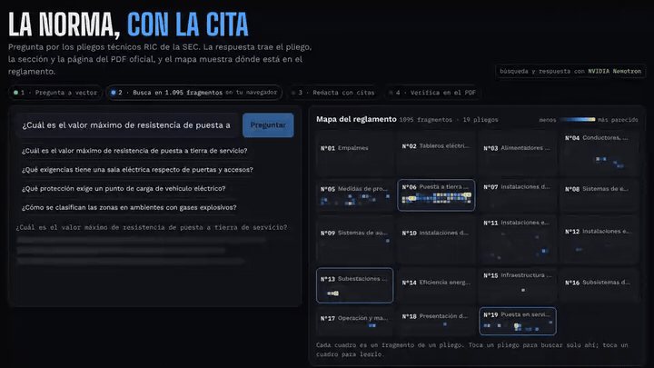
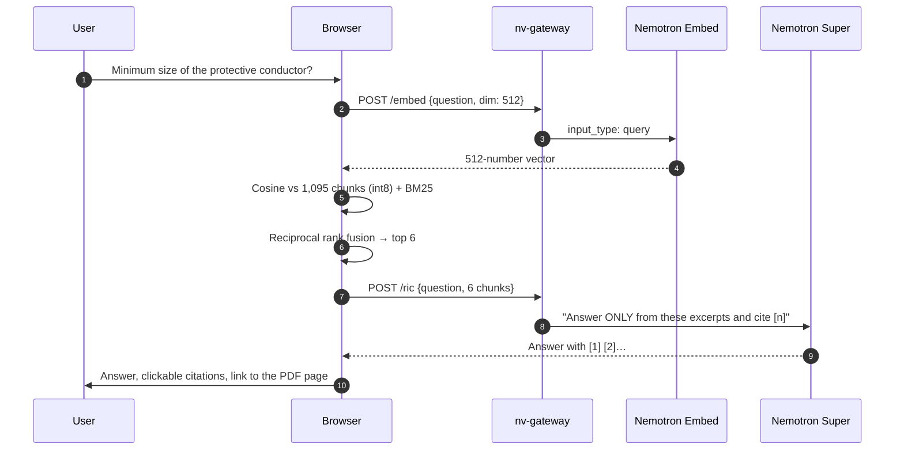
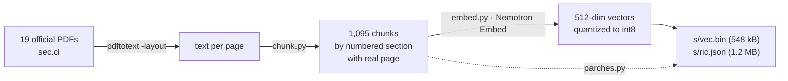

# RIC Lookup

**Ask about Chilean electrical regulations and get the exact citation: technical code (pliego), section and page of the official SEC PDF. A map shows where in the regulation the answer lives.**

[](https://jsnn15.github.io/normativa/)


[Español](README.md) · **English**

> The interface and the regulations are in Spanish.

<a href="https://jsnn15.github.io/normativa/"></a>

## The problem

The 19 RIC technical codes under Chile's electrical installation safety regulation (DS 8/2019) total about 490 pages. A generic chatbot answers confidently and without sources, which is useless for compliance. What helps is **the answer plus the page to verify it**.

## How it works





### How the index was built



- **Chunks by numbered section** (5.1, 5.1.2…), carrying chapter and section titles so each chunk stands alone. Annexes are detected separately and every piece keeps its **real page** in the PDF.
- **int8 vectors.** 1,095 × 512 bytes ship as a 548 kB static file; a full scan takes milliseconds in the browser.
- **Hybrid search.** Semantic similarity finds "tierra de servicio" even if you phrase it differently; BM25 makes exact terms like "IP54" or "30 mA" count. Both are merged with reciprocal rank fusion.
- **Grounded answer.** The model only gets the 6 chunks and must cite every claim. If the fact is missing, it says so first.
- **The map** colors all 1,095 chunks by similarity, so you can see whether the answer is concentrated in one code or spread out.

## Testing and limits

- Tested with real installer questions (service grounding, electrical rooms, EV charging, explosive atmospheres, protective conductor). The fast 30B model sometimes answered from an unrelated chunk, so **Nemotron Super** writes the answer and the fast model is only a fallback.
- **Tables.** `pdftotext` scrambles some tables. Critical ones are fixed by hand in `tools/parches.py` (e.g. Annex 6.7) and the model is told not to infer values from an unreadable table.
- A lookup aid: **it does not replace the current official code or a licensed installer's judgment.** Every answer ends by asking to verify at the source.

## Files

| File | What it is |
|---|---|
| `index.html` | UI, BM25, int8 vector search, fusion, map and citation viewer. |
| `s/ric.json`, `s/vec.bin` | Index: chunk text with code, section and page, plus vectors. |
| `tools/descargar.sh` | Downloads the 19 PDFs from sec.cl and extracts text. |
| `tools/chunk.py` | Splits by numbered section and assigns the real page. |
| `tools/embed.py` | Embeds with Nemotron Embed (needs `NVIDIA_API_KEY`) and quantizes to int8. |
| `tools/parches.py` | Manual table fixes. |

```bash
cd tools && ./descargar.sh && python3 chunk.py && NVIDIA_API_KEY=... python3 embed.py && python3 parches.py
```

## Source

RIC technical codes N°01 to N°19, Superintendencia de Electricidad y Combustibles (SEC), Exempt Resolution 33,877 of 2020 and updates (RIC N°15, 2024 version), downloaded from sec.cl in November 2026. Public documents; the index text is an automatic extraction and may contain errors. The official PDF is always the reference.

---

<sub>Personal project by **Julián Neira Nova**, electrical engineer with 10 years in mining operations · Servicio y Soluciones Tecnológicas DelaCruz SpA. Nothing here comes from clients or employers.
[Portfolio](https://jsnn15.github.io/) · [LinkedIn](https://www.linkedin.com/in/julian-neira-nova/) · [All tools](https://github.com/JSNN15)</sub>
