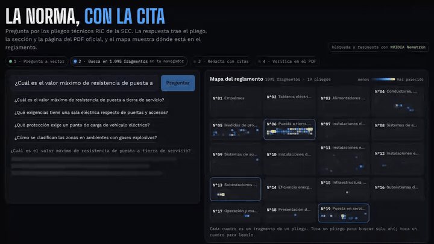
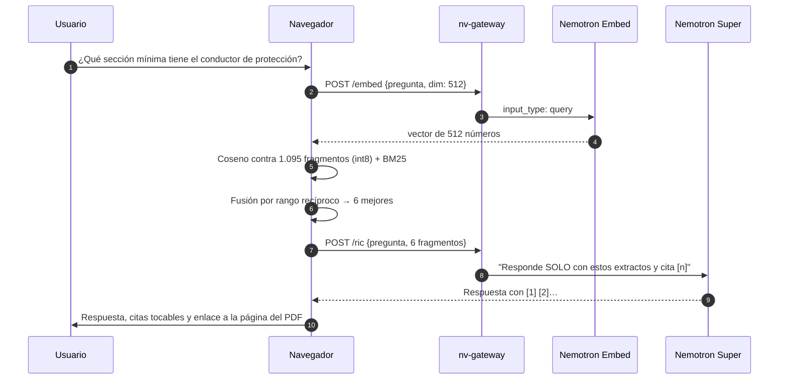
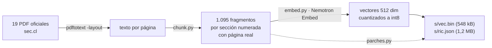

# Consulta RIC

> **Versión anterior.** La máquina actual es [Consulta eléctrica](https://github.com/JSNN15/consulta-electrica): un chat que sigue la conversación y compara cada cita con el texto oficial. El índice de pliegos de este repositorio (`s/ric.json` y `s/vec.bin`) sigue en uso: lo leen Consulta eléctrica y Supervisor normativo, así que este repositorio no se debe archivar ni renombrar.

**Preguntas por la normativa eléctrica chilena y la respuesta trae la cita exacta: pliego, sección y página del PDF oficial de la SEC. Un mapa muestra en qué parte del reglamento está la respuesta.**

[](https://jsnn15.github.io/normativa/)


**Español** · [English](README.en.md)

<a href="https://jsnn15.github.io/normativa/"></a>

## El problema

Los 19 pliegos técnicos RIC del Reglamento de Seguridad de las Instalaciones de Consumo (DS N°8/2019) suman unas 490 páginas. Un chatbot genérico responde con seguridad y sin fuente; en normativa eso no sirve. Lo que sirve es **la respuesta con la página donde verificarla**.

## Cómo funciona





### Cómo se armó el índice



- **Cortes por sección numerada** (5.1, 5.1.2…), con el título del capítulo y la sección, para que cada fragmento tenga sentido solo. Los anexos se detectan aparte y cada trozo guarda su **página real** dentro del PDF.
- **Vectores int8.** 1.095 × 512 bytes viajan como un archivo estático de 548 kB; la comparación completa tarda milisegundos en el navegador.
- **Búsqueda híbrida.** La similitud semántica encuentra "tierra de servicio" aunque preguntes "resistencia de puesta a tierra del neutro"; BM25 asegura que términos exactos como "IP54" o "30 mA" pesen. Se fusionan por rango recíproco.
- **Respuesta acotada.** El modelo recibe solo los 6 fragmentos y debe citar cada afirmación. Si el dato no aparece, lo dice en la primera frase.
- **El mapa** pinta los 1.095 fragmentos según su parecido con la pregunta: se ve si la respuesta está concentrada en un pliego o repartida.

## Pruebas y límites

- Se revisaron preguntas reales de instalador (puesta a tierra de servicio, sala eléctrica, carga de vehículos eléctricos, zonas explosivas, conductor de protección). En la prueba, el modelo rápido (30B) a veces respondía con un fragmento que no correspondía; por eso la respuesta la redacta **Nemotron Super**, y el rápido queda solo como respaldo.
- **Tablas.** `pdftotext` desordena algunas tablas. Las críticas se corrigen a mano en `tools/parches.py` (por ejemplo, la del Anexo 6.7) y el modelo tiene instrucción de no deducir valores de una tabla ilegible.
- Es una herramienta de consulta: **no reemplaza el pliego vigente ni el criterio de un instalador autorizado.** Cada respuesta termina pidiendo verificar en la fuente.

## Archivos

| Archivo | Qué es |
|---|---|
| `index.html` | La interfaz, BM25, la búsqueda vectorial int8, la fusión, el mapa y el visor de citas. |
| `s/ric.json`, `s/vec.bin` | Índice: texto de cada fragmento con pliego, sección y página, y sus vectores. |
| `tools/descargar.sh` | Descarga los 19 PDF desde sec.cl y extrae el texto. |
| `tools/chunk.py` | Corta por sección numerada y asigna la página real. |
| `tools/embed.py` | Vectoriza con Nemotron Embed (necesita `NVIDIA_API_KEY`) y cuantiza a int8. |
| `tools/parches.py` | Correcciones manuales de tablas. |

```bash
cd tools && ./descargar.sh && python3 chunk.py && NVIDIA_API_KEY=... python3 embed.py && python3 parches.py
```

## Fuente

Pliegos Técnicos Normativos RIC N°01 a N°19, Superintendencia de Electricidad y Combustibles (SEC), Resolución Exenta N°33.877 de 2020 y actualizaciones (RIC N°15 versión 2024), descargados de sec.cl en noviembre de 2026. Son documentos públicos; el texto del índice es una extracción automática y puede contener errores: la referencia es siempre el PDF oficial.

---

<sub>Proyecto personal de **Julián Neira Nova**, ingeniero eléctrico con 10 años en faena · Servicio y Soluciones Tecnológicas DelaCruz SpA. Nada de lo publicado proviene de clientes ni de empleadores.
[Portafolio](https://jsnn15.github.io/) · [LinkedIn](https://www.linkedin.com/in/julian-neira-nova/) · [Todas las máquinas](https://github.com/JSNN15)</sub>
